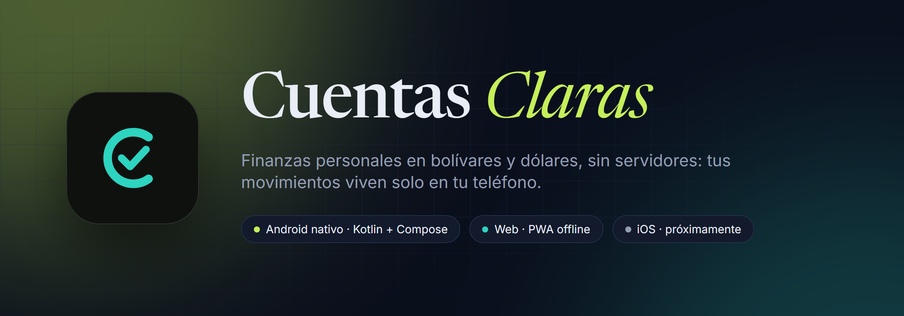
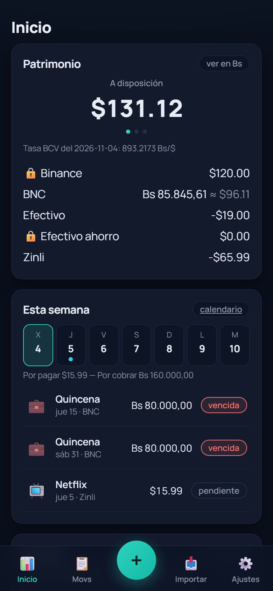
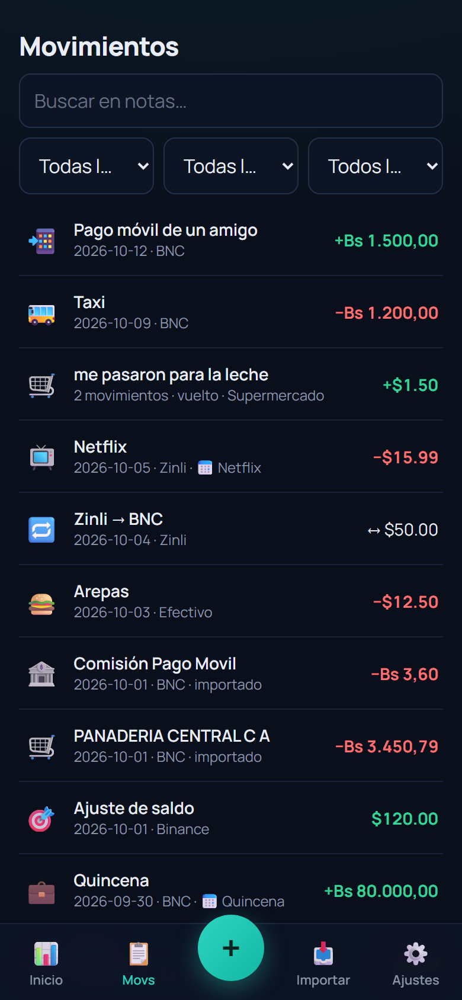
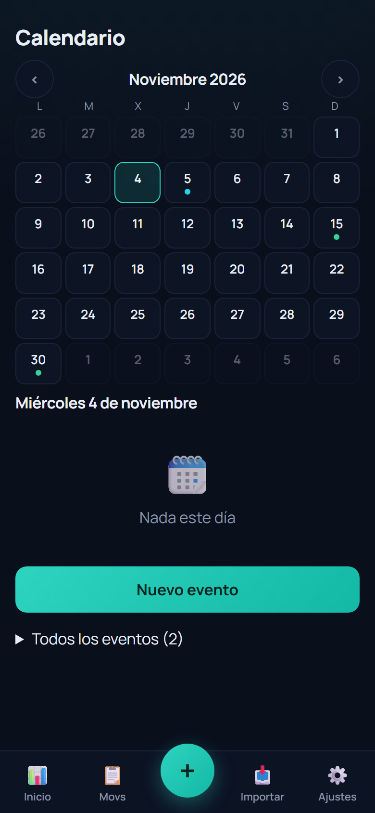
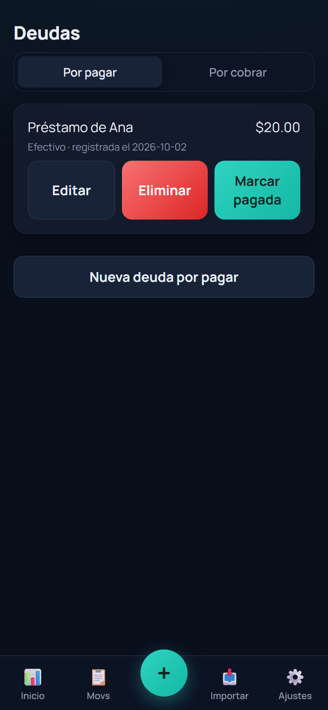

<p align="center">
  
</p>

<p align="center">
  <a href="https://github.com/DanCas03/cuentas-claras/releases/latest"></a>
  
  
  
  <a href="LICENSE"></a>
</p>

**Cuentas Claras** es una app de finanzas personales hecha para la realidad venezolana: varias
cuentas, dos monedas (bolívares y dólares), tasa BCV y paralela, pagos móviles, Zinli, Binance y
efectivo. Sin servidores ni cuentas de usuario: **todos tus movimientos viven solo en tu teléfono**.

Funciona hoy en **Android nativo** y en la **web**. La versión para **iOS** es el siguiente objetivo.

---

## Descargar

| Plataforma | Estado | Cómo |
|---|---|---|
| **Android** (8.0+) | ✅ Estable | Baja el APK de la [última release](https://github.com/DanCas03/cuentas-claras/releases/latest) e instálalo. Es la versión recomendada. |
| **Web / PWA** | ✅ Funciona | Ábrela en [cuentas-claras-r2f.pages.dev](https://cuentas-claras-r2f.pages.dev) e instálala desde el navegador, o córrela tú mismo (ver [Web](#web-pwa)). |
| **iOS** | 🎯 Objetivo | En planificación. Si sabes Swift/SwiftUI y quieres ayudar, abre un issue. |

> Al instalar el APK, Android avisará que viene de «fuente desconocida». Es normal para apps que no
> están en Play Store. Las releases están firmadas con la misma clave, así que las actualizaciones se
> instalan encima sin perder datos.

---

## Qué hace

<p align="center">
  
  
  
  
</p>
<p align="center"><sub>Capturas de la versión web con datos de demostración. Las de la app Android llegan pronto.</sub></p>

- **Varias cuentas, dos monedas.** BNC en bolívares; Zinli, Binance y efectivo en dólares. El
  patrimonio se ve en USD o en Bs con la tasa del día, y cada cuenta puede marcarse como ahorro
  para que no cuente como «a disposición».
- **Tasas reales.** BCV y Binance USDT/VES se consultan solas; eliges cuál manda en las
  conversiones. Cada movimiento guarda la tasa con la que se registró.
- **Captura de notificaciones del BNC** (Android). La app lee la notificación del banco y crea el
  movimiento con monto, referencia y categoría sugerida. Nada de teclear pagos móviles.
- **Import del estado de cuenta.** Pega o importa el TXT del BNC y la app detecta duplicados,
  aplica las reglas que aprendió de tus categorías anteriores y te deja corregir antes de guardar.
- **Calendario de pagos y cobros.** Quincena, Netflix, condominio: eventos con repetición
  (semanal, mensual, quincenal, anual), estado (pendiente, vencida, hecha) y asignación de
  movimientos en un toque.
- **Grupos de movimientos.** Un pago móvil y su vuelto en efectivo son una sola compra, con
  categoría propia para el residuo.
- **Deudas** por pagar y por cobrar, en cualquiera de las cuentas, con liquidación que genera
  el movimiento correspondiente.
- **Estadísticas** por mes y categoría, comparativa contra el mes anterior y presupuestos.
- **Respaldos** en un JSON que entiende tanto la app Android como la web, para pasar datos
  entre las dos o guardarlos en Drive.
- **Apariencia.** Seis paletas oscuras y cinco claras, tres fuentes y tres íconos de app a elegir.

---

## Privacidad

No hay backend. La app no pide registro, no manda nada a ningún servidor propio y no tiene
analítica. Las únicas conexiones salientes son las consultas públicas de tasas (BCV y Binance).
Los datos están en la base local del teléfono (Room en Android, IndexedDB en la web) y salen
solo cuando tú exportas un respaldo.

Los comprobantes, notificaciones y respaldos reales del autor están en `.gitignore` y nunca se
commitean. Los fixtures de los tests son sintéticos.

---

## El repositorio

```
android/   App nativa: Kotlin + Jetpack Compose + Room. Desarrollo activo.
src/       Versión web (TypeScript + React + Vite). Misma lógica de negocio.
docs/      Guías de uso, investigación, specs y planes.
```

Las reglas de negocio (dinero, tasas, saldos, grupos, deudas, calendario) están duplicadas a
propósito en `android/.../domain/` y `src/domain/`, como código puro con tests en ambos lados.
Un respaldo exportado en una plataforma se restaura en la otra.

### Android

Requisitos y detalles en [`android/README.md`](android/README.md). Diseño visual en
[`android/DESIGN.md`](android/DESIGN.md).

```bash
cd android
./gradlew :app:assembleDebug        # APK debug
./gradlew :app:testDebugUnitTest    # tests unitarios (JVM)
```

Para compilar una **release firmada** hacen falta cuatro propiedades en tu
`~/.gradle/gradle.properties` (`CUENTAS_KEYSTORE`, `CUENTAS_KEYSTORE_PASS`, `CUENTAS_KEY_ALIAS`,
`CUENTAS_KEY_PASS`). Sin ellas, `assembleRelease` compila pero el APK sale sin firmar.

### Web (PWA)

```bash
npm install
npm run dev        # desarrollo
npm run test:run   # tests (Vitest)
npm run build      # typecheck + build en dist/
npm run preview    # sirve el build (necesario para probar el modo offline)
```

La instancia pública está en Cloudflare Pages: **https://cuentas-claras-r2f.pages.dev** (puede ir
por detrás de `main`; el desarrollo activo está en la app Android). Para publicar tu propia copia,
sube `dist/` a cualquier hosting con HTTPS. El proyecto trae `wrangler.toml`:
`npx wrangler pages deploy dist --project-name cuentas-claras`.

Guías para usuarios: [permisos en Android](docs/guia-permisos.md) y
[captura con MacroDroid](docs/guia-macrodroid.md) (la alternativa a la captura nativa para la PWA).

---

## Detalles de comportamiento

<details>
<summary><b>Calendario y eventos</b></summary>

Un **evento** es una fecha en la que hay que pagar o cobrar algo. No es dinero: no altera saldos
ni estadísticas. Sus **ocurrencias** se derivan de la regla de repetición cada vez que se dibujan;
lo único que se guarda es la definición del evento y, en cada movimiento asignado, el par
`eventId` + `eventDate`.

- **Crear**: Pago o Cobro, categoría (obligatoria: define la dirección), cuenta esperada y monto
  opcionales, fecha y repetición (Una vez · Cada semana · Cada mes · Quincenal (15 y último) ·
  Cada año). En «Cada mes», `31` significa **último día del mes**.
- **Terminar una suscripción**: pon una fecha de Fin (chip «Terminar hoy»).
- **Estados**: hecha (tiene movimientos) > omitida > vencida > pendiente. Hoy cuenta como pendiente.
- **Asignar un movimiento**: en Nuevo, el chip del evento guarda y asigna en **un toque** (copia la
  categoría del evento, editable antes de guardar); en el editor, con el selector «Evento»; en la
  vista previa de los imports, el evento sugerido gana a la regla aprendida y queda corregible.
- **Sugerencia**: la ocurrencia puede estar hasta 31 días antes del movimiento o 7 después, y el
  monto esperado debe coincidir ±10 % (si el evento tiene monto).
- **Eliminar un evento** nunca borra movimientos: los desasigna y conservan su categoría.
</details>

<details>
<summary><b>Grupos con categoría del vuelto</b></summary>

Un grupo puede llevar una **categoría del vuelto**. Se aplica solo si su tipo coincide con el
signo del residuo (gasto para un residuo negativo, ingreso para uno positivo); si no coincide, el
residuo cuenta como «Vuelto». Los movimientos del grupo conservan su propia categoría.
</details>

<details>
<summary><b>«Este mes» expandible</b></summary>

La tarjeta «Este mes» tiene navegación de mes (acotada entre el mes más antiguo con movimientos y
el actual) que gobierna también Comparativa y Presupuestos, y un botón «Ver todas las categorías».
Tocar una categoría abre Movimientos ya filtrado por esa categoría y ese mes.
</details>

<details>
<summary><b>Formato de respaldo</b></summary>

`schemaVersion: 3` (9 tablas, incluye `calEvents`). Los respaldos **v2 se aceptan** y se normalizan
al importarlos; los v1 se rechazan. El mismo archivo sirve en Android y en la web.
</details>

<details>
<summary><b>Documentos de diseño</b></summary>

- Spec original: `docs/superpowers/specs/2026-07-07-finanzas-personales-design.md`
- Plan de implementación: `docs/superpowers/plans/2026-07-07-cuentas-claras-implementacion.md`
- Investigación para la app nativa: `docs/research/`
</details>

---

## Hoja de ruta

- [x] Web / PWA con captura por MacroDroid
- [x] App Android nativa con captura de notificaciones integrada
- [x] Calendario, grupos, deudas, respaldos compatibles
- [ ] **iOS** (rama `ios`): misma lógica de negocio, interfaz nativa en SwiftUI
- [ ] Capturas de la app Android en este README
- [ ] Publicación en tiendas

---

## Contribuir

Las contribuciones entran por pull request desde un fork; no hace falta ser colaborador. Lee
[`CONTRIBUTING.md`](CONTRIBUTING.md) para el flujo, las reglas del proyecto y cómo compilar.
Para bugs e ideas hay plantillas de issue.

## Licencia

[MIT](LICENSE). Úsalo, modifícalo y compártelo; solo conserva el aviso de copyright.
